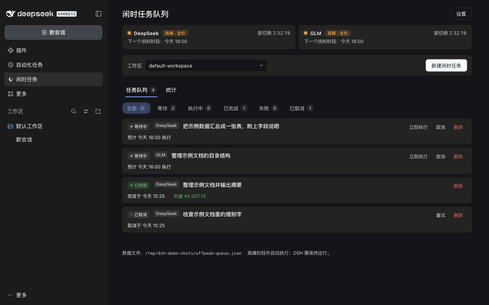
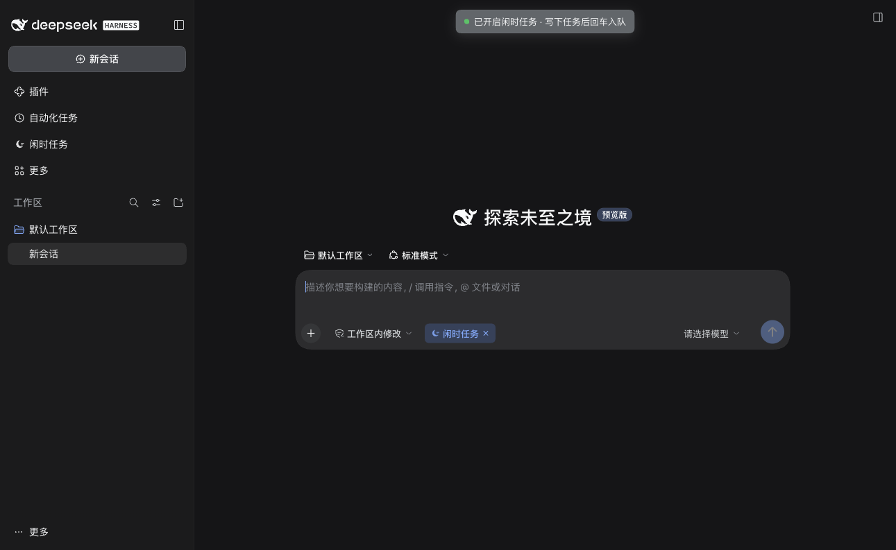
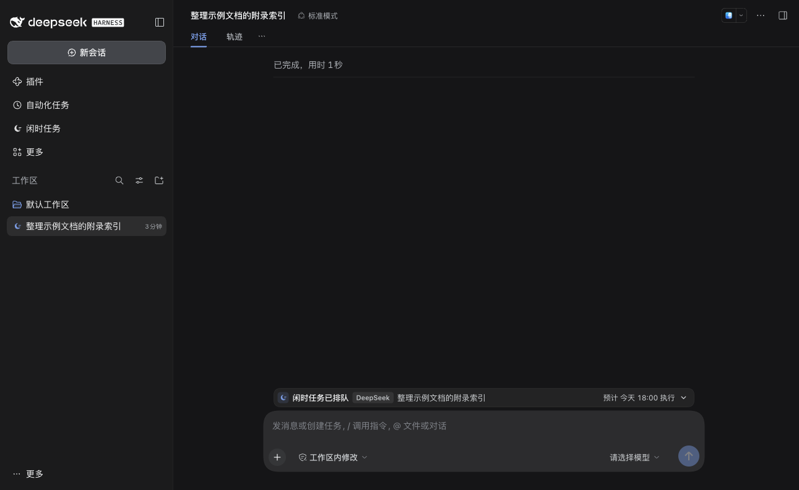
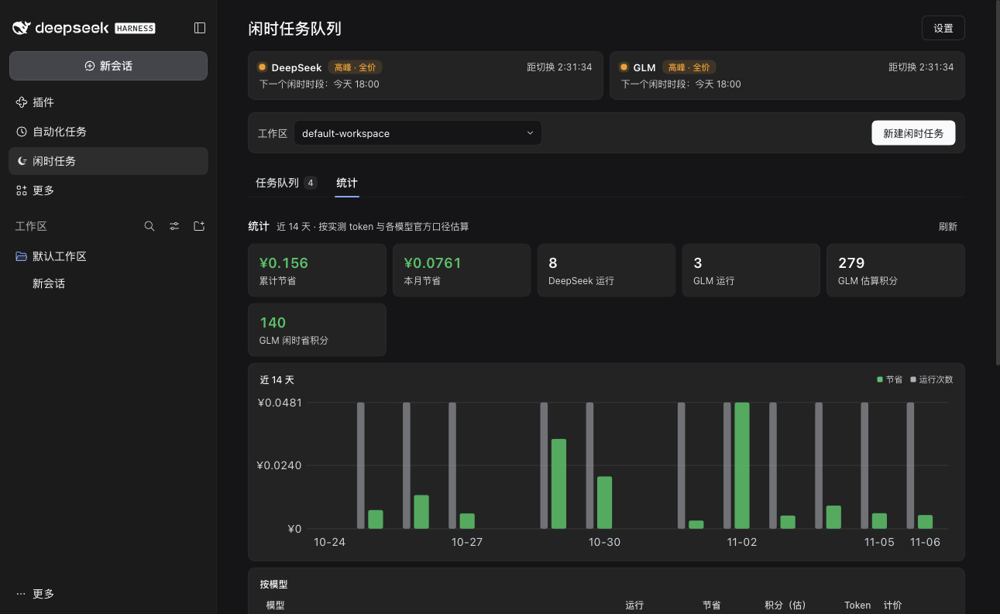
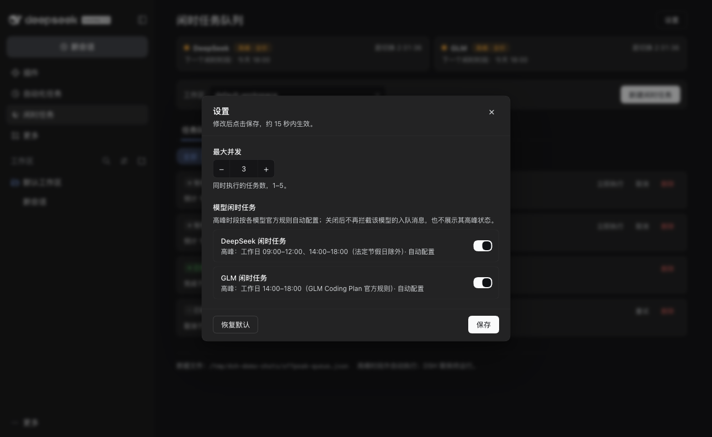

# 闲时任务队列 · dsh-offpeak-queue

[](./LICENSE)
[](#安装)
[](https://api-docs.deepseek.com/zh-cn/quick_start/pricing/)
[](./test)

> **一句话：** 在对话里输入 `/闲时任务`，写下要做的事——**这一刻不调用模型、不花一分钱**——到了所用模型的闲时时段（DeepSeek 半价、GLM Coding Plan 积分五折），任务会在**同一个对话**里自动执行。
>
> **In one line:** a DSH plugin that lets you queue a task from any conversation with **zero model calls at queue time**, then runs it automatically in that same conversation during the off-peak hours of the model you use (DeepSeek half price; GLM Coding Plan at half credits).



---

## 目录

- [为什么用它](#为什么用它)
- [功能](#功能)
- [安装](#安装)
- [使用](#使用)
- [截图](#截图)
- [工作原理](#工作原理)
- [已知限制](#已知限制)
- [开发与测试](#开发与测试)
- [许可](#许可)
- [English](#english)

## 为什么用它

插件按「模型家族」内置官方峰谷规则（自动配置，无需手填）：

- **DeepSeek**（[价格页](https://api-docs.deepseek.com/zh-cn/quick_start/pricing/)）：北京时间**周一至周五（不含法定节假日）09:00–12:00、14:00–18:00 为高峰全价**，其余时间为**闲时半价**。
- **GLM**（[GLM Coding Plan](https://docs.bigmodel.cn/cn/coding-plan/overview)）：北京时间**周一至周五 14:00–18:00 为高峰全积分**，其余时间模型调用**按 50% 积分抵扣**（官方规则未设节假日豁免）。

不急的事没必要在高峰付全价。这个插件把「等会儿再做」变成一条队列：

- **排队零成本**：开启 `/闲时任务` 后提交的任务在 `agent/pre-step` 被拦截并结束本轮，不产生任何模型请求。
- **按模型自动排期**：任务按创建时对话所用模型的高峰日历排队——用 GLM 就等 GLM 的闲时，用 DeepSeek 就等 DeepSeek 的闲时，互不影响。
- **在来源对话里执行**：到点在同一条对话继续，上下文、贴图、工作区都在，不是另开一个陌生会话。
- **自动挑闲时**：排队任务只在其模型的闲时自动开始；执行中跨入高峰会继续跑完，费用按每一步实际完成时刻分别计价。
- **省钱看得见**：DeepSeek 按官方价目表 × 真实 token 估算节省金额；GLM 按官方积分系数 × 真实 token 估算积分消耗与闲时节省（Coding Plan 为积分制，均标注「估算、非账单」）。
- **按模型开关**：设置弹窗里可以关闭某个模型的闲时任务——关闭后不再拦截该模型的入队消息，面板也不再展示它的峰谷状态。
- **只在本机**：队列、统计、设置都保存在本机 JSON 文件里，插件本身不联网（积分不向 GLM 服务器查询，按官方系数本地估算）。

## 功能

| | |
|---|---|
| **对话内排队** | 输入框输入 `/闲时任务` 回车开启，工具条出现「闲时任务 ×」小标签；写下任务回车即入队，**不产生模型回复**。 |
| **面板管理** | 侧栏「闲时任务」面板：任务队列 / 统计两个页签，全部 / 等待 / 执行中 / 已完成 / 失败 / 已取消六个状态筛选。 |
| **多模型峰谷** | 标题下一排**等宽状态卡**，按已开启的模型分别展示 DeepSeek / GLM 的峰谷徽章、切换倒计时和下一闲时时段；「设置」按钮打开居中弹窗，可开关各模型的闲时任务、调节最大并发。 |
| **分模型统计** | 统计页分模型卡片（DeepSeek 节省金额、GLM 估算积分）、按模型表格（含积分与 Token 列）、图表叠加运行次数、近期执行带模型标识。 |
| **新建即排队** | 面板里选好工作区（下拉可搜索）点「新建闲时任务」，会在该工作区打开新对话并自动开启 `/闲时任务`。 |
| **对话内状态卡** | 输入框上方一条与对话内容列同宽的状态卡：图标 + 状态 + 标题 + 时间；可展开查看详情、**修改**、取消、重新入队、删除。 |
| **修改零调用** | 点「修改」把任务内容回填到输入框，像聊天一样改（可贴图），回车保存；执行时用最新版本。 |
| **立即执行** | 任务行的「立即执行」任何时段都能手动跑（高峰会按全价计费并提示）。 |
| **完成提醒** | 任务完成时面板入口出现绿色小点，不弹横幅、不打扰。 |
| **中英双语 · 明暗主题** | 界面语言跟随 DSH，窄到 520px 仍可用。 |
| **日志自愈** | 0.2.1 起不再写会话日志；启动时会自动检测并修复旧版本写坏的会话日志（原文件自动备份）。 |

## 安装

> 环境：DeepSeek Harness（DSH）桌面端 / web profile。插件是 Host + Client 两半的 bundle，Host 需要 `webServer` 等平台服务。

**方式一：命令行（推荐）**

```bash
git clone https://github.com/Thomas-zz/dsh-offpeak-queue.git

# macOS 桌面端的 dsh CLI 在 app 内：
DSH="/Applications/DeepSeek Harness.app/Contents/Resources/runtime/cli/bin/dsh"

# 安装到你的 profile（会以 link: 方式链接源码目录，并自动登记 bundle）
"$DSH" plugin --profile desktop add "$PWD/dsh-offpeak-queue"
```

然后**重启 DSH 桌面端**（Host 部分改动需要重启；Client `client.js` 改动保存后热更新）。

**方式二：插件管理器**

在 DSH 的「设置 → 插件」里从本地目录安装 `dsh-offpeak-queue`，再确认 profile 的 `dsh.profile.bundles` 里已包含 `dsh-offpeak-queue`（`dsh plugin add` 会自动加）。

**数据文件**

```
~/.dsh/offpeak-queue.json
```

可用环境变量 `DSH_OFFPEAK_DATA_FILE` 指定其他路径（便于隔离测试）。卸载：设置 → 插件里禁用/移除，或 `"$DSH" plugin --profile <profile> remove dsh-offpeak-queue`。

## 使用

1. 在任意对话输入框输入 `/闲时任务`（或从 `/` 指令菜单选「闲时任务」）回车开启。
2. 工具条出现「闲时任务 ×」标签；写下任务描述回车，任务入队且**不会产生模型回复**。会话标题自动改为任务标题本身（不加任何前缀，侧栏用月亮图标标记闲时会话）。
3. 输入框上方的状态卡可以展开查看详情、**修改**、**取消**；面板里也能操作。
4. 到闲时（半价时段）任务在同一条对话里自动执行，对话中出现一张「插件状态更新」触发卡（不是冒充用户发出的消息）。
5. 侧栏「闲时任务」面板查看队列和省钱统计；面板图标上的绿点表示有任务完成且未查看，点任务标题可跳到来源对话。





## 截图

| 统计 | 设置 |
|---|---|
|  |  |

## 工作原理

```
对话输入 /闲时任务 → 输入框开启「armed」
        │
        ▼
用户提交任务 ──► agent/pre-step 拦截（Host）──► 登记任务、结束本轮
        │                          │ 零模型调用，不写会话日志
        ▼                          ▼
   任务队列（本机 JSON）◄── 面板 / 修改 / 取消 / 立即执行
        │
        ▼
  调度引擎：只在闲时启动，最大并发默认 3
        │
        ▼
  Runner：向来源会话注入「插件状态更新」触发卡，把任务正文与贴图送回对话
        │
        ▼
  正常 agent loop 执行 → 记录 token/费用 → 统计节省
```

- 实现细节与 Host/Client 约定见 [docs/ARCHITECTURE.md](./docs/ARCHITECTURE.md)。
- Host 为纯 ESM、无第三方依赖；Client 是单个浏览器 bundle，只依赖平台 React。
- 队列调度由 DSH 进程负责：电脑休眠或 DSH 退出时任务不会丢失，会顺延到下一个闲时窗口。

## 已知限制

- 任务由 DSH 进程调度，闲时到来时 DSH 需要保持运行；休眠/退出会顺延。
- 开启 `/闲时任务` 后如果没写任务就继续聊天，那条消息会被当作任务入队，请先取消标签。
- 开启后但**还没提交**时贴进输入框的图片由插件在内存中保管，页面刷新或重启后无法还原；已提交任务的图文都持久化在队列里。
- 费用与积分均为**估算**：DeepSeek 按官方价目表 × 实测 token，GLM 按官方积分系数 × 实测 token（MCP 工具积分不计入），不是账户账单；其他模型只统计 token 不计价；搜索/抓取等额外费用不计入。
- GLM 官方未提供公开的积分查询 API（Coding Plan 用量只有登录态网页），插件按官方积分公式本地估算，任务结束后即汇总展示。
- 内置法定节假日为 **2026 年**（仅 DeepSeek 家族；GLM 官方高峰规则未设节假日豁免），其他年份按工作日估算。
- 任务按**创建时**对话所用模型排期，创建后切换模型不改变排期；未识别的模型按 DeepSeek 日历处理。
- 指令输入名固定为中文 `/闲时任务`（界面语言为英文时菜单标题会本地化，输入名不变）。
- 任务在来源对话执行，使用该对话的权限预设；无人值守任务建议使用 `approval: never` 的预设，否则可能卡在审批上。

## 开发与测试

```bash
# 插件目录内，无需安装依赖（Host 纯 ESM，测试用 node:test）
node --test
```

- 架构与行为契约：[docs/ARCHITECTURE.md](./docs/ARCHITECTURE.md)
- 会话日志安全检查：`node scripts/verify-session-log-safety.mjs --dsh <dsh 目录>`
- 手动修复旧版本写坏的会话日志：`node scripts/repair-session-logs.mjs [--dry-run]`
- 状态卡宽度校验：`scripts/dock-width-check.html`（无头 Chrome 渲染，见脚本注释）

## 许可

[MIT](./LICENSE) © 2026 Thomas-zz

---

## English

**dsh-offpeak-queue** is a DSH (DeepSeek Harness) plugin for people who have work that can wait.

Each model family carries its own built-in off-peak rule: DeepSeek bills half price outside weekday 09:00–12:00 and 14:00–18:00 Beijing time (holidays excluded), and the GLM Coding Plan credits calls at 50% outside weekday 14:00–18:00 (UTC+8). A task is scheduled on the calendar of the model its conversation uses, so this plugin turns "I'll deal with it later" into a queue:

1. In any conversation type `/闲时任务` — this only *arms* the composer; it makes **no model call**. Write the task and press Enter: the Host intercepts it in `agent/pre-step`, stores it, and ends the turn at zero cost.
2. The task appears as a one-line status card above the composer, in the sidebar queue and in the queue panel. You can edit it (also at zero cost), cancel it, retry it, or run it immediately.
3. During that model's off-peak hours the scheduler runs the task **in the same conversation**, waking the agent with a plugin status card that carries the task text and images. Savings are estimated per family — DeepSeek in CNY from the official price table, GLM in Coding-Plan credits from the official coefficients × measured tokens (no network calls) — and reported in the stats tab.

Requirements: DSH desktop/web; install with `dsh plugin --profile <profile> add <repo-dir>` and restart DSH. Data stays local in `~/.dsh/offpeak-queue.json`; the plugin itself makes no network calls. License: MIT.
